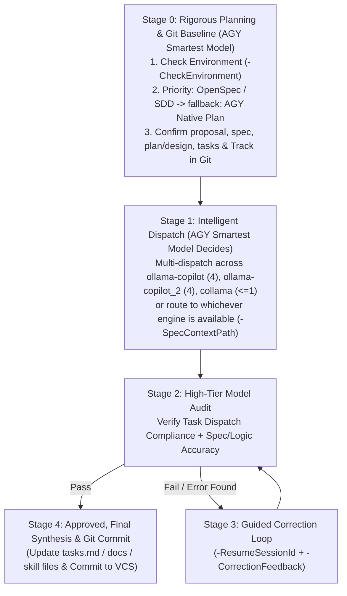

# Copilot Subagent Orchestrator (`collama`, `ollama-copilot`, `ollama-copilot_2` + SDD Planning) — `v1.1.0`

> **Version**: `v1.1.0` (Supports 3 Copilot CLI engines & collama TPM/RPM concurrency limit reduction to 1)

This skill enables Antigravity (`agy`) to act as the **Lead Architect & Supervisor** using its smartest available Gemini model (e.g., Gemini 4 Argon / Pro tier) to:
1. **Plan rigorously first** (prioritizing **OpenSpec / SDD** if installed on the machine, otherwise falling back to **AGY's native Plan**).
2. **Dynamically dispatch** confirmed `proposal`, `spec`, `plan`, and `tasks` across up to three GitHub Copilot CLI engines:
   - **`collama`**: Max **1** subagent (hard cap to avoid TPM/RPM rate limits).
   - **`ollama-copilot`**: Default **4** subagents (unrestricted).
   - **`ollama-copilot_2`**: Default **4** subagents (unrestricted, second copilot CLI instance).
3. **Audit & correct** all outputs via a closed-loop review workflow.

---

## 1. Engine Subagent Concurrency & Availability Rules

| Engine | Concurrency Limit | Availability & Routing Policy |
| :--- | :--- | :--- |
| **`collama`** | **At most 1 (`<= 1`)** | **Hard Cap (TPM/RPM Guard)**: Never run > **1** concurrent subagent. If assigned > 1 subtask, batch serially (1 subagent per wave, wait with `read_agent`, then start next wave). |
| **`ollama-copilot`** | **Default 4 (Unrestricted)** | **Default 4**: Runs up to **4** parallel subagents simultaneously by default; no hard upper ceiling. |
| **`ollama-copilot_2`** | **Default 4 (Unrestricted)** | **Default 4**: Functionally identical to `ollama-copilot`, providing an extra parallel copilot CLI instance for multi-way dispatch. |
| **`auto` / Multi-Dispatch** | **Dynamic (`agy` Decides)** | `agy`'s smartest Gemini model can dispatch across all three engines simultaneously (e.g., 4 subtasks to `ollama-copilot`, 4 subtasks to `ollama-copilot_2`, 1 focused subtask to `collama`), or route dynamically to available engines. |

---

## 2. Mandatory 5-Stage End-to-End Workflow

Every non-trivial task handled with this skill **MUST** follow this 5-stage workflow driven by `agy`'s smartest available Gemini model (active top-tier primary model or `invoke_subagent` with `Model: "pro"` / `"inherit"`):



### Stage 0: Environment Probe & Rigorous SDD / Plan Generation (最聰明模型嚴謹規劃)

When `agy` receives a task, **before** dispatching work to subagents:
1. **Probe SDD Tools & Engine Availability**:
   Run [Invoke-CopilotSubagents.ps1](./scripts/Invoke-CopilotSubagents.ps1) with `-CheckEnvironment`:
   ```powershell
   pwsh -File "c:\Users\d1658\Documents\project\call_subagent_skill\.agents\skills\copilot-subagent-orchestrator\scripts\Invoke-CopilotSubagents.ps1" -CheckEnvironment
   ```
2. **Author `proposal`, `spec`, `plan` (`design`), and `tasks` Using the Highest-Priority Planning Tool**:
   - **Priority 1 — OpenSpec / SDD Installed (`PreferredPlanningTool: "openspec"` / `"openspec-tw"` / `"specify"`)**:
     - If `openspec` is installed and the workspace is not yet initialized, run `openspec init --tools none` (if appropriate for the project) and `openspec new change <change-name>`.
     - Using `agy`'s smartest Gemini model, author the 4 core SDD artifacts under `openspec/changes/<change-name>/` (or a dedicated spec folder):
       1. `proposal.md` — Problem statement, scope, goals, and non-goals.
       2. `specs/<domain>/spec.md` — Concrete requirements, scenarios (`WHEN/THEN`), and invariants.
       3. `design.md` (`plan`) — Architecture, implementation approach, and verification strategy.
       4. `tasks.md` — Granular checklist partitioned into independent subtasks ready for dispatch.
   - **Priority 2 — Fallback to AGY Native Plan (`PreferredPlanningTool: "agy-native-plan"`)**:
     - If no SDD CLI is installed, use AGY's built-in Plan capability (writing an implementation plan markdown file/artifact) containing the exact same 4 sections: **Proposal**, **Spec**, **Plan**, and **Tasks**.

### Stage 1: Dynamic Engine Selection & Intelligent Dispatch (由 AGY 最聰明模型決定派工策略)

Once `plan`, `proposal`, `spec`, and `tasks` are confirmed, `agy`'s smartest Gemini model decides how to assign the tasks in `tasks.md` across `ollama-copilot`, `ollama-copilot_2`, and `collama`:
- **Strategy A — Three-Engine Parallel Multi-Dispatch (三引擎協同派工)**:
  - Assign large parallelizable task groups (e.g., 3–4 subtasks) to **`ollama-copilot`** (`-Engine ollama-copilot -MaxSubagents 4`).
  - Simultaneously assign another parallel task group (e.g., 3–4 subtasks) to **`ollama-copilot_2`** (`-Engine ollama-copilot_2 -MaxSubagents 4`).
  - Simultaneously assign a focused single task to **`collama`** (`-Engine collama -MaxSubagents 1`).
- **Strategy B — Dynamic Selection or Auto-Failover (看哪個可以用就用誰)**:
  - If any engine endpoint is unreachable (reported by `-CheckEnvironment`), route tasks to the healthy engines.
  - `-Engine auto` automatically picks an online engine and fails over if an error occurs.
- Always pass `-SpecContextPath "<path-to-openspec-change-or-plan>"` so the confirmed `proposal`, `spec`, `design/plan`, and `tasks` are injected directly into the subagents' prompt context.

### Stage 2: High-Tier Model Audit (AGY 最聰明模型審查)

After the engines finish, `agy`'s smartest model audits the outputs against the confirmed `spec` and `tasks`:
1. **Task Dispatch Compliance (工作派遣合規性)**:
   - Did `collama` strictly obey `<= 1` concurrent subagent?
   - Did `ollama-copilot` and `ollama-copilot_2` run their expected parallel subagents (default 4)?
   - Were all assigned items from `tasks.md` completed?
2. **Logical & Spec Accuracy (邏輯與規格正確性)**:
   - Do the outputs and any modified files strictly satisfy every requirement and scenario in `spec.md` / `design.md`?
   - Are there any logical flaws, edge-case bugs, or hallucinations?

### Stage 3: Guided Correction Loop (退回重新訂正與檢查)

If **any** flaw or spec violation is found in Stage 2:
1. Extract the session UUID (`Resume copilot --resume=<session-uuid>`) from the failed engine's output.
2. Call `Invoke-CopilotSubagents.ps1` with `-ResumeSessionId "<session-uuid>"`, `-SpecContextPath "<spec-path>"`, and `-CorrectionFeedback "<detailed flaw + fix instructions>"` so the engine resumes its session and fixes the issue.

### Stage 4: Re-Audit, Sign-Off & Mandatory Version Control (複查確認與文件/技能包強制納入版控)

1. Re-audit the corrected output. Once all `spec` requirements and `tasks.md` items pass, mark `tasks.md` items complete (`- [x]`).
2. **Mandatory Version Control Policy (文件與技能包皆須納入 Git 版控)**:
   - Every SDD/Planning document (`openspec/`, `proposal.md`, `spec.md`, `design.md`, `tasks.md`, `README.md`) and any workspace Skill package (`.agents/skills/`) **MUST** be tracked in Git version control so future updates, modifications, rollbacks, and debugging have a complete history.
   - If the workspace is not yet a Git repository (`GitInitialized: false` in `-CheckEnvironment`), run `git init` and ensure `.gitignore` does **NOT** exclude `.agents/skills/` or `openspec/`.
   - Stage and commit all updated documentation, specs, skill package files, and code changes (`git add` + `git commit`) with a clear, structured commit message before concluding the task.

---

## 3. Command Reference (`Invoke-CopilotSubagents.ps1`)

### 1. Check SDD Tools & Engine Availability
```powershell
pwsh -File "c:\Users\d1658\Documents\project\call_subagent_skill\.agents\skills\copilot-subagent-orchestrator\scripts\Invoke-CopilotSubagents.ps1" -CheckEnvironment
```

### 2. Multi-Dispatch Across Three Engines
```powershell
# Engine 1: ollama-copilot (4 parallel subagents)
pwsh -File "c:\Users\d1658\Documents\project\call_subagent_skill\.agents\skills\copilot-subagent-orchestrator\scripts\Invoke-CopilotSubagents.ps1" `
  -Engine ollama-copilot `
  -MaxSubagents 4 `
  -SpecContextPath ".\openspec\changes\<change-id>" `
  -Prompt "Execute Tasks Group A according to the attached OpenSpec." `
  -Tasks "Task 1.1: ...", "Task 1.2: ...", "Task 1.3: ...", "Task 1.4: ..."

# Engine 2: ollama-copilot_2 (4 parallel subagents)
pwsh -File "c:\Users\d1658\Documents\project\call_subagent_skill\.agents\skills\copilot-subagent-orchestrator\scripts\Invoke-CopilotSubagents.ps1" `
  -Engine ollama-copilot_2 `
  -MaxSubagents 4 `
  -SpecContextPath ".\openspec\changes\<change-id>" `
  -Prompt "Execute Tasks Group B according to the attached OpenSpec." `
  -Tasks "Task 2.1: ...", "Task 2.2: ...", "Task 2.3: ...", "Task 2.4: ..."

# Engine 3: collama (Strict Max 1 subagent for TPM/RPM safety)
pwsh -File "c:\Users\d1658\Documents\project\call_subagent_skill\.agents\skills\copilot-subagent-orchestrator\scripts\Invoke-CopilotSubagents.ps1" `
  -Engine collama `
  -MaxSubagents 1 `
  -SpecContextPath ".\openspec\changes\<change-id>" `
  -Prompt "Execute Task Group C according to the attached OpenSpec." `
  -Tasks "Task 3.1: ..."
```

### 3. Guided Correction Call (`-ResumeSessionId` + `-CorrectionFeedback`)
```powershell
pwsh -File "c:\Users\d1658\Documents\project\call_subagent_skill\.agents\skills\copilot-subagent-orchestrator\scripts\Invoke-CopilotSubagents.ps1" `
  -Engine <collama|ollama-copilot|ollama-copilot_2> `
  -ResumeSessionId "<session-uuid>" `
  -SpecContextPath ".\openspec\changes\<change-id>" `
  -CorrectionFeedback "AGY Spec Audit Failed: Task 1.2 violated Requirement X in spec.md. Re-dispatch a subagent to fix and verify."
```

> See [cli-flags-and-patterns.md](./references/cli-flags-and-patterns.md) for detailed OpenSpec CLI commands, failover behavior, and Copilot CLI subagent flags.
