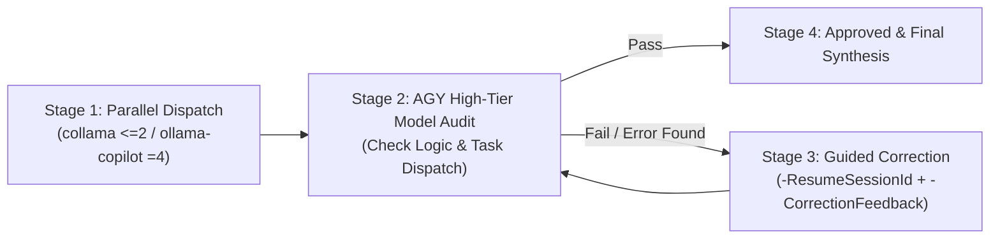

# Copilot Subagent Orchestrator (`collama` & `ollama-copilot`)

This skill enables Antigravity (`agy`) to invoke and control `collama` and `ollama-copilot` in parallel via PowerShell (`pwsh`), enforce engine-specific subagent concurrency limits, and audit their outputs using `agy`'s highest-tier model with a closed-loop correction workflow.

## 1. Mandatory Subagent Concurrency Rules

Both `collama` and `ollama-copilot` wrap GitHub Copilot CLI (`copilot`) with custom BYOK providers in PowerShell `$PROFILE` and support spawning parallel background subagents (`--fleet` and the internal `task` / `read_agent` tools). You **MUST** enforce their respective subagent concurrency limits:

| Engine | Concurrency Limit | Concurrency & Batching Rule |
| :--- | :--- | :--- |
| **`collama`** | **At most 2 (`<= 2`)** | **Hard Cap**: Never allow `collama` to run more than **2** concurrent subagents at the same time. If a job has > 2 subtasks, instruct `collama` to batch them in waves of at most 2 parallel subagents (`task` in `mode: "background"`), wait with `read_agent`, then start the next wave. |
| **`ollama-copilot`** | **Default 4 (Unrestricted)** | **Default 4**: By default, instruct `ollama-copilot` to run up to **4** parallel subagents simultaneously. It has no hard ceiling and may scale higher if explicitly requested by the user. |

---

## 2. Mandatory AGY High-Tier Model Review & Correction Loop (最高等模型審查與退回訂正機制)

Because `collama` and `ollama-copilot` run fast flash-tier models (`deepseek-v4.1-flash`), **`agy` MUST act as the Lead Supervisor and Auditor using `agy`'s highest-tier model** (either directly in the primary `agy` agent when running on a top-tier/Pro model, or by delegating review to a subagent with `Model: "pro"` / `Model: "inherit"`).

Every orchestration execution **MUST** follow this 4-stage closed-loop workflow:



### Stage 1: Parallel Dispatch (平行工作派遣)
- `agy` can invoke `collama` and `ollama-copilot` simultaneously in parallel `run_command` tool calls (or individually) via [Invoke-CopilotSubagents.ps1](./scripts/Invoke-CopilotSubagents.ps1).

### Stage 2: High-Tier Model Audit (AGY 最高等模型邏輯與派遣審查)
After `collama` and/or `ollama-copilot` return their outputs, `agy` **MUST** critically audit the results against two mandatory checklists before presenting them as done:
1. **Task Dispatch Compliance (工作派遣合規性審查)**:
   - Did `collama` strictly obey the `<= 2` concurrent background subagent cap per wave?
   - Did `ollama-copilot` dispatch its expected parallel background subagents (default `4`)?
   - Were **all** assigned subtasks actually executed and answered without silent skips or truncation?
2. **Logical & Content Accuracy (邏輯與內容正確性審查)**:
   - Are all calculations, code changes, file inspections, and reasoning steps logically sound and free of contradictions or hallucinations?
   - Does the output satisfy every explicit and implicit constraint of the task?
   - If files were created or edited, inspect the actual files on disk to verify correctness.

### Stage 3: Guided Correction Loop (退回重新訂正與檢查)
If **any** logical flaw, content error, constraint violation, or incomplete subtask dispatch is found during Stage 2:
1. **Do NOT accept the flawed output.**
2. Extract the session UUID from the footer of the failed engine's output (`Resume copilot --resume=<session-uuid>`).
3. Formulate specific, actionable supervisor guidance in `-CorrectionFeedback` explaining:
   - **What is wrong**: The exact logical error, wrong value, or missing subtask.
   - **How to fix it**: Clear instructions on how to recalculate, re-verify, or re-run the affected subtask(s).
4. Re-invoke `Invoke-CopilotSubagents.ps1` with `-Engine <collama|ollama-copilot> -ResumeSessionId "<session-uuid>" -CorrectionFeedback "<guidance>"` so the engine resumes its session, fixes the mistake, and re-verifies.

### Stage 4: Re-Audit & Approval (複查確認)
- `agy` audits the corrected output from Stage 3 again. Repeat Stage 3 -> Stage 4 (up to 3 correction rounds) until the output passes all logical and dispatch checks.

---

## 3. Invoking via Helper Script (Recommended)

Use [Invoke-CopilotSubagents.ps1](./scripts/Invoke-CopilotSubagents.ps1) (also installed globally at `$HOME\.gemini\config\skills\copilot-subagent-orchestrator\scripts\Invoke-CopilotSubagents.ps1`).

### A. Initial Parallel Dispatch (`collama` + `ollama-copilot`)

**1. Calling `collama` (Hard Cap: Max 2 Parallel Subagents):**
```powershell
pwsh -File "c:\Users\d1658\Documents\project\call_subagent_skill\.agents\skills\copilot-subagent-orchestrator\scripts\Invoke-CopilotSubagents.ps1" `
  -Engine collama `
  -MaxSubagents 2 `
  -WorkingDirectory "<target-repo-path>" `
  -Prompt "Coordinate the subtasks and synthesize the findings." `
  -Tasks "Subtask 1: ...", "Subtask 2: ..."
```

**2. Calling `ollama-copilot` (Default: 4 Parallel Subagents):**
```powershell
pwsh -File "c:\Users\d1658\Documents\project\call_subagent_skill\.agents\skills\copilot-subagent-orchestrator\scripts\Invoke-CopilotSubagents.ps1" `
  -Engine ollama-copilot `
  -MaxSubagents 4 `
  -WorkingDirectory "<target-repo-path>" `
  -Prompt "Run all subtasks in parallel and return a consolidated report." `
  -Tasks "Subtask 1: ...", "Subtask 2: ...", "Subtask 3: ...", "Subtask 4: ..."
```

### B. Guided Correction Call (When AGY Audit Detects an Error)

```powershell
pwsh -File "c:\Users\d1658\Documents\project\call_subagent_skill\.agents\skills\copilot-subagent-orchestrator\scripts\Invoke-CopilotSubagents.ps1" `
  -Engine <collama|ollama-copilot> `
  -ResumeSessionId "<session-uuid-from-previous-run>" `
  -CorrectionFeedback "Audit Failed: (1) In Subtask 2, your calculation/logic violated constraint X because Y. (2) Re-dispatch a subagent to fix Subtask 2, verify the result, and output the corrected table."
```

---

## 4. Direct PowerShell Invocation (Without Wrapper Script)

If calling `collama` or `ollama-copilot` directly in PowerShell:
1. Ensure `$PROFILE` is loaded: `if (-not (Get-Command collama -ErrorAction SilentlyContinue)) { . $PROFILE }`
2. **Initial Dispatch**:
   - `collama --fleet --no-ask-user -p "STRICT RULE: Launch AT MOST 2 parallel subagents at a time (wave batch if >2). Task: ..."`
   - `ollama-copilot --fleet --no-ask-user -p "Use up to 4 parallel subagents simultaneously. Task: ..."`
3. **Correction via Session Resume**:
   - `collama --fleet --no-ask-user --resume=<session-uuid> -p "[AGY SUPERVISOR CORRECTION]: <specific error and fix instructions>"`
   - `ollama-copilot --fleet --no-ask-user --resume=<session-uuid> -p "[AGY SUPERVISOR CORRECTION]: <specific error and fix instructions>"`

> **Important**: Never pass `-s` (`--silent`) to `ollama-copilot`, as `--autopilot`'s final `task_complete` call causes `-s` to drop the synthesis output. See [cli-flags-and-patterns.md](./references/cli-flags-and-patterns.md) for details.
